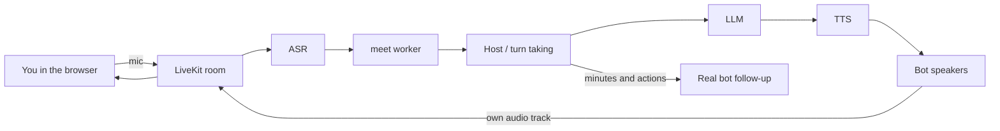

# grokbot-voice-meeting

A human and several AI agents meet **by voice** in one room. Each agent has its own brief, its own voice, and its own tile. A host runs the agenda: opening round, cues, raised hands. When you speak, every bot stops.

Built so any [Grok Bot](https://github.com/RussGuo/grokbot-voice-meeting) can start a meeting from "who + topic" and hand you a join link. LiveKit Cloud, Volcengine Doubao speech, and DeepSeek are the defaults. Each layer can be swapped.


## Quickstart

Python 3.11+. From a clone:

```bash
python -m venv .venv && . .venv/bin/activate
pip install -e ".[dev]"          # add ".[all]" if you want local sherpa ASR/TTS
cp .env.example .env             # then fill in keys, or skip them and use the demo
meet demo                        # simulated meeting, no keys, no network
meet doctor --offline            # what a live meeting still needs
```

Live meeting, two terminals:

```bash
# terminal A — leave this running; it reads each meeting from job metadata
meet worker

# terminal B
cp bots.example.yaml bots.yaml   # put real context in; do not invent facts
meet --who pm,eng --topic "What ships this month" --agenda "scope;risks"
```

`meet` prints a join URL. Open it. The worker must be running before `meet`, or the room will be empty.

`meet demo` writes a text transcript with `FakeVoiceLayer`. It is the no-keys walkthrough of turn-taking, barge-in, and minutes.

## Architecture



One LiveKit agent session holds the floor. Each bot also joins as its own participant (`BotSpeakers`), so the active tile lights up. The worker's own track stays silent on purpose; the acceptance check measures the bot tracks.

## Grok Bot

Install [`skills/voice-meeting/SKILL.md`](skills/voice-meeting/SKILL.md) into the bot that should start meetings. The user says "start a voice meeting with my X and Y bots about Z". The bot exports each participant's real context, runs `meet` on its Linux box, and returns the join link.

In-meeting questions the stand-in cannot answer use `PrincipalClient` (`orchestrator/principal.py`):

| `MEETING_PRINCIPAL` | Behavior |
|---|---|
| `mock` (default) | Placeholder reply. Tests and `meet demo`. |
| `file` | Question JSON in `outbox/`, answer JSON in `inbox/`. |
| `webhook` | POST the question. `{"text": "..."}` is delivered; otherwise the file inbox is used. |

Afterward, `meet followup runs/<id>` writes a prompt per bot from `minutes.md` and `actions/<bot>.json`. Send that prompt to the real bot. This repo does not write into a bot's memory by itself.

## Providers

Defaults: LiveKit, Volcengine Doubao streaming ASR and seed-tts, DeepSeek. Any OpenAI-compatible chat endpoint is `LLM_PROVIDER=openai` plus `LLM_BASE_URL`. OpenAI Whisper / TTS is `VOICE_ASR_PROVIDER=openai` and `VOICE_TTS_PROVIDER=openai`. Speaker ids are [`config/voices.json`](config/voices.json), not Python constants.

How to add an adapter: [docs/PROVIDERS.md](docs/PROVIDERS.md).

### LiveKit Cloud

1. Create a project on [LiveKit Cloud](https://cloud.livekit.io/). The Build plan is the free tier; limits are on their pricing page and change, so check there before a public launch.
2. Copy the WebSocket URL, API key, and secret into `.env` as `LIVEKIT_URL`, `LIVEKIT_API_KEY`, `LIVEKIT_API_SECRET`.
3. `meet worker` registers the agent name `voice-meeting` (`LIVEKIT_AGENT_NAME`). `meet` dispatches that name.

### Volcengine / Doubao

1. Open the [Volcengine speech console](https://www.volcengine.com/product/speech) and create an API key (or the older app id + access token).
2. Set `VOLC_API_KEY`. ASR resource defaults to `volc.seedasr.sauc.duration`, TTS to `seed-tts-2.0`.
3. New accounts usually receive trial credit. The catalog in `config/voices.json` lists speaker ids from Doubao's public voice list. Confirm the id still exists in your account before a demo.

### DeepSeek

1. Create a key at [DeepSeek](https://platform.deepseek.com/).
2. `DEEPSEEK_API_KEY`, optional `DEEPSEEK_BASE_URL` (default `https://api.deepseek.com`) and `DEEPSEEK_MODEL` (default `deepseek-flash`).
3. Billing is per token. Brief summarization is one short call per bot and is cached under `~/.cache/grokbot-voice-meeting/briefs/`.

### Cost

`meet demo` and `pytest` call no paid API. A live meeting spends LiveKit participant-minutes, ASR/TTS audio seconds, and LLM tokens. Free tiers and trial credit are enough for a handful of short meetings; they are not a quota this repo can promise. `meet doctor` tells you which keys are missing and whether TCP to LiveKit and the LLM host succeeds. It never prints secret values.

## Join page without a tunnel

`meet` writes two URLs when `MEETING_JOIN_PAGE` is set:

- your static page, with `?liveKitUrl=` and `?token=`
- `https://meet.livekit.io/custom?...` as the fallback

`web/index.html` is static. It uses the query token when present and only calls `/api/token` otherwise. Host it anywhere, including GitHub Pages:

1. Enable Pages for this repo on the `/` (or `/docs`) root, or publish the `web/` directory.
2. Set `MEETING_JOIN_PAGE` to that `index.html` URL.
3. Open the link `meet` prints. The browser talks to LiveKit Cloud directly. You do not expose the token server.

`python web/token_server.py` remains for local development (binds `127.0.0.1` unless `WEB_HOST` says otherwise).

## Configuration

| Variable | Default | Role |
|---|---|---|
| `LIVEKIT_URL` / `LIVEKIT_API_KEY` / `LIVEKIT_API_SECRET` | empty | LiveKit project |
| `LIVEKIT_AGENT_NAME` | `voice-meeting` | Worker name `meet` dispatches |
| `DEEPSEEK_API_KEY` / `DEEPSEEK_BASE_URL` / `DEEPSEEK_MODEL` | mock if unset | Default LLM |
| `LLM_PROVIDER` / `LLM_BASE_URL` / `LLM_API_KEY` / `LLM_MODEL` | `auto` | Any OpenAI-compatible LLM |
| `VOICE_ASR_PROVIDER` / `VOICE_TTS_PROVIDER` | `auto` | `volc` `aliyun` `openai` `local` |
| `VOLC_API_KEY` | empty | Doubao speech |
| `OPENAI_API_KEY` | empty | OpenAI speech, or `LLM_API_KEY` |
| `VOICE_CATALOG` | `config/voices.json` | Speaker ids |
| `MEETING_HUMAN_IDENTITY` | `host` | Must match the join token identity |
| `MEETING_HUMAN_NAME` | `You` / `用户` | Spoken and on-screen name |
| `MEETING_LANG` | `zh` | `zh` or `en` prompts and host script |
| `MEETING_MODERATOR_ID` | `moderator` | Neutral host. Not a persona. |
| `MEETING_JOIN_PAGE` | empty | Static join page; else meet.livekit.io |
| `MEETING_PRINCIPAL` | `mock` | `mock` `file` `webhook` |
| `MEETING_BOTS` | `./bots.yaml` | Registry of bots and context |

Sample scenarios under `orchestrator/bots/` still include a chief-of-staff host. That is fixture data for the original tests. New meetings from `meet` use `moderator`.

## Docker

```bash
docker compose up worker
```

The image installs the package, reads `.env`, and runs `meet worker`. It does not bake in keys. See [Dockerfile](Dockerfile) and [docker-compose.yml](docker-compose.yml).

## Development

```bash
pip install -e ".[dev]"
pytest                          # orchestrator, meet, providers — no keys
pytest voice/tests              # voice layer — no keys
ruff check meet providers orchestrator/scene.py orchestrator/i18n.py orchestrator/commitments.py
meet demo --run-dir runs/demo
```

GitHub Actions runs the same lint and tests on push.

## License

MIT. See [LICENSE](LICENSE).

Contributing, security reports, and the code of conduct: [CONTRIBUTING.md](CONTRIBUTING.md), [SECURITY.md](SECURITY.md), [CODE_OF_CONDUCT.md](CODE_OF_CONDUCT.md).
