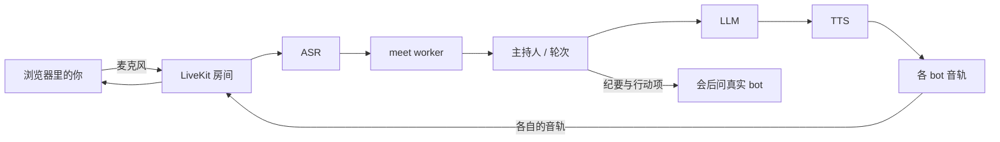

# grokbot-voice-meeting

人和若干 AI 智能体在同一个房间里**用语音开会**。每个智能体有自己的 brief、自己的音色、自己的头像格。主持人按议程推进：开场、点名、举手。你一开口，所有 bot 立刻停下。

任何 Grok Bot 都可以从「谁 + 议题」开一场会，并把入会链接交还给你。默认是 LiveKit Cloud、火山引擎豆包语音、DeepSeek。每一层都可以换。


## 快速开始

需要 Python 3.11+。在克隆下来的仓库里：

```bash
python -m venv .venv && . .venv/bin/activate
pip install -e ".[dev]"          # 要用本地 sherpa 语音再加 ".[all]"
cp .env.example .env             # 填写密钥；只想看模拟会议可以先不填
meet demo                        # 不需要密钥，也不联网
meet doctor --offline
```

真开会，开两个终端：

```bash
# 终端 A：一直开着。每场会的场景从 job metadata 读
meet worker

# 终端 B
cp bots.example.yaml bots.yaml   # 写上真实上下文，不要编造事实
meet --who pm,eng --topic "这个月发什么" --agenda "范围;风险"
```

`meet` 会打印入会链接。先有 worker，再跑 `meet`，否则房间里没有人说话。

`meet demo` 用文本模拟一整场会（轮次、插话、纪要），不调用任何付费接口。

## 架构



一个 LiveKit agent 会话拿着发言权。每个 bot 再以自己的身份进房（`BotSpeakers`），正在说话的格子会亮。编排器自己那条音轨是静音，验收脚本量的是 bot 的音轨。

## 接到 Grok Bot

把 [`skills/voice-meeting/SKILL.md`](skills/voice-meeting/SKILL.md) 装进负责开会的那个 bot。用户说「叫我的 X 和 Y 开一场语音会，议题是 Z」。bot 把每个参会者**真实拥有**的上下文导出成文件，在自己的 Linux 上跑 `meet`，把链接交回来。

会中答不上来的问题走 `PrincipalClient`（`orchestrator/principal.py`）：

| `MEETING_PRINCIPAL` | 行为 |
|---|---|
| `mock`（默认） | 占位答复。测试和 `meet demo` 用这个。 |
| `file` | 问题写在 `outbox/`，真实 bot 把答复写进 `inbox/`。 |
| `webhook` | POST 问题。响应里有 `{"text": "..."}` 就当场采用，否则仍看文件收件箱。 |

会后 `meet followup runs/<id>` 根据 `minutes.md` 和 `actions/<bot>.json` 给每个 bot 写一段提示词。把这段交给**真实的** bot 去确认、更正或撤回。这个仓库不会自行写入 bot 的记忆。

## 提供者

默认：LiveKit、豆包流式 ASR 与 seed-tts、DeepSeek。别的 OpenAI 兼容接口用 `LLM_PROVIDER=openai` 加 `LLM_BASE_URL`。OpenAI Whisper / TTS 用 `VOICE_ASR_PROVIDER=openai` 和 `VOICE_TTS_PROVIDER=openai`。音色 id 在 [`config/voices.json`](config/voices.json)，不写死在代码里。

新增适配器：[docs/PROVIDERS.md](docs/PROVIDERS.md)。

### LiveKit Cloud

1. 在 [LiveKit Cloud](https://cloud.livekit.io/) 建项目。Build 计划是免费档，额度以官网为准，会变。
2. 把 WebSocket 地址、API key、secret 填进 `.env` 的 `LIVEKIT_URL`、`LIVEKIT_API_KEY`、`LIVEKIT_API_SECRET`。
3. `meet worker` 以 `voice-meeting` 这个名字注册（`LIVEKIT_AGENT_NAME`）。`meet` 派发的就是这个名字。

### 火山引擎 / 豆包

1. 打开[火山引擎语音](https://www.volcengine.com/product/speech)，创建 API key（或旧版 app id + access token）。
2. 设置 `VOLC_API_KEY`。ASR 资源默认 `volc.seedasr.sauc.duration`，TTS 默认 `seed-tts-2.0`。
3. 新账号通常有试用额度。`config/voices.json` 里的 speaker id 来自豆包公开音色表，上线前在你自己的账号里确认还能用。

### DeepSeek

1. 在 [DeepSeek](https://platform.deepseek.com/) 创建 key。
2. `DEEPSEEK_API_KEY`，可选 `DEEPSEEK_BASE_URL`（默认 `https://api.deepseek.com`）和 `DEEPSEEK_MODEL`（默认 `deepseek-flash`）。
3. 按 token 计费。每个 bot 的 brief 摘要只打一次，缓存在 `~/.cache/grokbot-voice-meeting/briefs/`。

### 费用

`meet demo` 和 `pytest` 不打付费接口。真开会会消耗 LiveKit 的参会分钟、语音的音频秒数和 LLM 的 token。免费档和试用额度够开几场短会，具体额度以各家官网为准。`meet doctor` 只报告缺哪些变量、以及到 LiveKit 和 LLM 主机的 TCP 是否通，不会打印密钥。

## 不打隧道的入会页

设置了 `MEETING_JOIN_PAGE` 时，`meet` 会给出两个地址：

- 你的静态页面，查询串里带 `liveKitUrl` 和 `token`
- 备用的 `https://meet.livekit.io/custom?...`

`web/index.html` 是静态文件。地址里已经有 token 就直接入会，否则才请求 `/api/token`。可以放到任意静态托管，包括 GitHub Pages：

1. 为仓库打开 Pages，发布根目录或 `web/`。
2. `MEETING_JOIN_PAGE` 设成那个 `index.html` 的 URL。
3. 打开 `meet` 打印的链接。浏览器直连 LiveKit Cloud，不必把 token 服务暴露到公网。

`python web/token_server.py` 仍留给本机开发（默认只绑 `127.0.0.1`）。

## 配置

| 变量 | 默认 | 作用 |
|---|---|---|
| `LIVEKIT_URL` / `LIVEKIT_API_KEY` / `LIVEKIT_API_SECRET` | 空 | LiveKit 项目 |
| `LIVEKIT_AGENT_NAME` | `voice-meeting` | worker 名字，`meet` 按这个派发 |
| `DEEPSEEK_API_KEY` / `DEEPSEEK_BASE_URL` / `DEEPSEEK_MODEL` | 不填则 mock | 默认 LLM |
| `LLM_PROVIDER` / `LLM_BASE_URL` / `LLM_API_KEY` / `LLM_MODEL` | `auto` | 任意 OpenAI 兼容 LLM |
| `VOICE_ASR_PROVIDER` / `VOICE_TTS_PROVIDER` | `auto` | `volc` `aliyun` `openai` `local` |
| `VOLC_API_KEY` | 空 | 豆包语音 |
| `OPENAI_API_KEY` | 空 | OpenAI 语音，也可复用 `LLM_API_KEY` |
| `VOICE_CATALOG` | `config/voices.json` | 音色 id |
| `MEETING_HUMAN_IDENTITY` | `host` | 必须和入会 token 的 identity 一致 |
| `MEETING_HUMAN_NAME` | `你` / `用户` | 显示名和称呼 |
| `MEETING_LANG` | `zh` | `zh` 或 `en`，提示词和主持稿 |
| `MEETING_MODERATOR_ID` | `moderator` | 中立主持人，不是某个固定人设 |
| `MEETING_JOIN_PAGE` | 空 | 静态入会页；空则用 meet.livekit.io |
| `MEETING_PRINCIPAL` | `mock` | `mock` `file` `webhook` |
| `MEETING_BOTS` | `./bots.yaml` | bot 注册表和上下文 |

`orchestrator/bots/` 里的样例场景仍由 Chief of Staff 主持，那是原来的测试数据。`meet` 开的新会议用 `moderator`。

## Docker

```bash
docker compose up worker
```

镜像安装本包，读取 `.env`，运行 `meet worker`。密钥不会打进镜像。见 [Dockerfile](Dockerfile) 和 [docker-compose.yml](docker-compose.yml)。

## 开发

```bash
pip install -e ".[dev]"
pytest
pytest voice/tests
ruff check meet providers orchestrator/scene.py orchestrator/i18n.py orchestrator/commitments.py
meet demo --run-dir runs/demo
```

GitHub Actions 在推送时跑同样的检查。

## 许可

MIT，见 [LICENSE](LICENSE)。

贡献、安全报告、行为准则：[CONTRIBUTING.md](CONTRIBUTING.md)、[SECURITY.md](SECURITY.md)、[CODE_OF_CONDUCT.md](CODE_OF_CONDUCT.md)。
